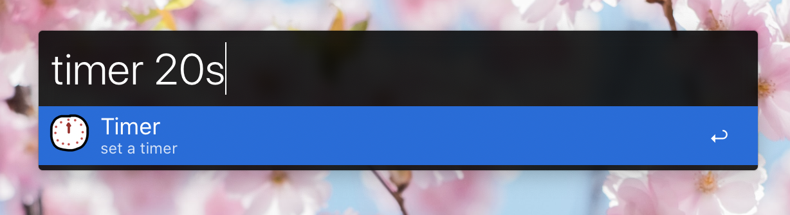
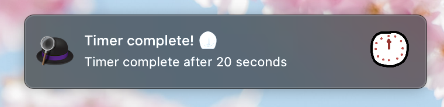
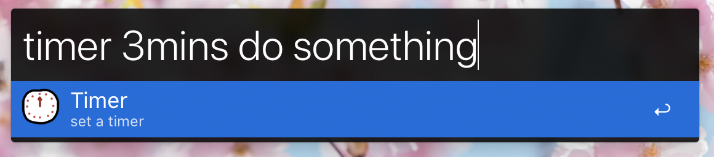
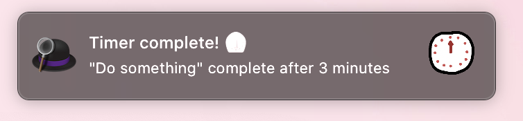
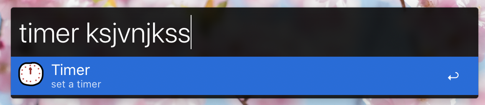
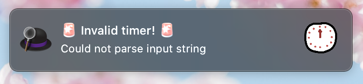

# An Alfred Timer

A simple timer app for [Alfred](https://www.alfredapp.com/) using launchd.

Setting a timer adds a one-time job to launchd (MacOS's [system service management daemon](https://en.wikipedia.org/wiki/Launchd)), so unlike some other Alfred timers, it won't create a new process for each timer.

## Screenshots

<table style="width:100%">
    <tr>
        <td></td>
        <td></td>
    </tr>
</table>

### With a title

<table style="width:100%">
    <tr>
        <td></td>
        <td></td>
    </tr>
</table>

### Invalid input

<table style="width:100%">
    <tr>
        <td></td>
        <td></td>
    </tr>
</table>

## Requirements

None beyond macOS and Alfred: the workflow is written in JavaScript for Automation, which ships with macOS.

## Usage

`timer <duration> [title]` sets a timer, e.g. `timer 10s`, `timer 5m tea` or `timer 1h30m bake bread`.

`timer` on its own lists active timers. Select one to cancel it. (Active timers are also listed below the "Set a timer" result while you type.)

A duration is one or more numbers with units, with or without spaces:

* Seconds: 's', 'sec', 'secs', 'second', 'seconds'
* Minutes: 'm', 'min', 'mins', 'minute', 'minutes'
* Hours: 'h', 'hr', 'hrs', 'hour', 'hours'

✅ - "20s", "5 mins", "3m30s", "1.5h", "2 Hours"

❌ - "20" (no unit), "0s"

Timers survive logging out or restarting: they are restored at login, and any that finished in the meantime are notified then.

## Development

`make test` runs the tests for parsing and formatting, and `make` builds `Timer.alfredworkflow`.
